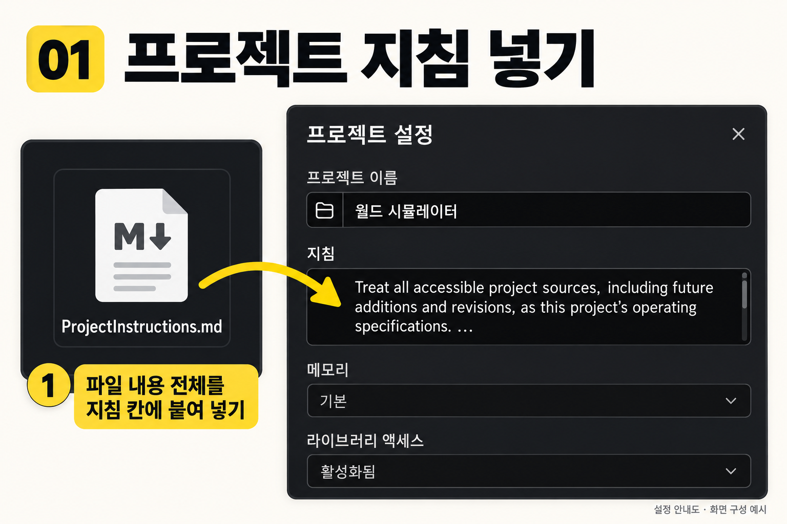
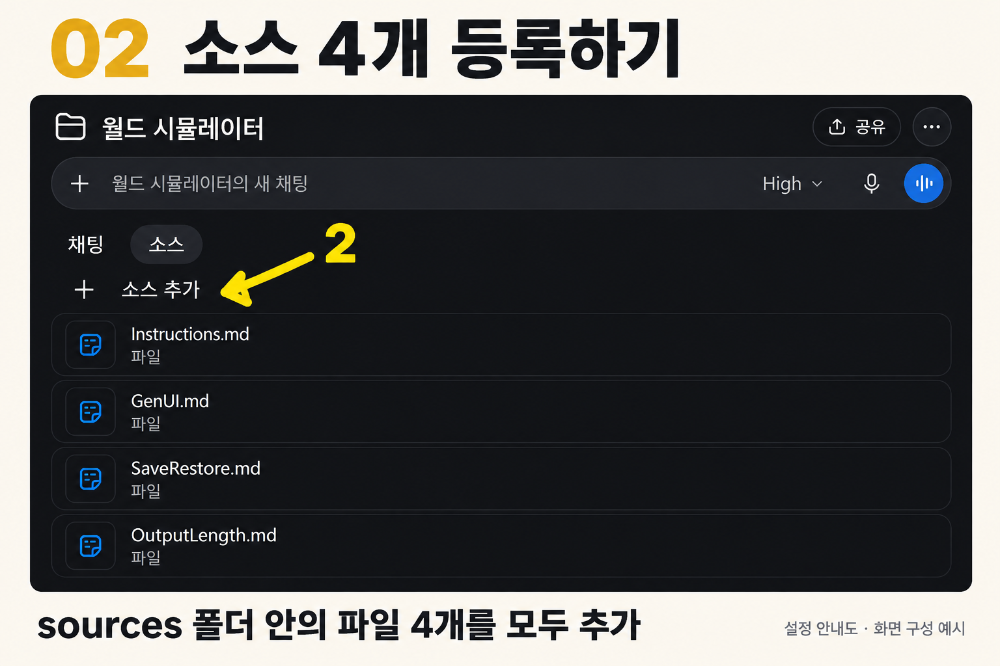

# World Simulator v6 · Singulari-Tea Codex

**월드 시뮬레이터 정식 릴리즈 v6** · 제작 **fewweekslater**

원작 속 세계, 역사 속 시대, 직접 만든 세계에서 한 인물의 삶을 대화와 행동으로 이어가는 서사 시뮬레이터입니다. 인물의 능력과 관계, 몸 상태, 시간과 주변 상황이 선택의 결과에 함께 작용합니다.

This repository distributes the official **World Simulator v6 ChatGPT project package**, based on the GPT edition. Choose a world and a protagonist, then explore through dialogue and freeform actions. [English quick start](#english-quick-start)

[**v6 ZIP 다운로드**](project-packages/v6/world-simulator-chatgpt-project-v6.zip?raw=1) · [패키지 파일 보기](project-packages/v6/world-simulator-chatgpt-project-v6/) · [Google Drive 다운로드](https://drive.google.com/file/d/1yjqCoBeJfrFFY5KYkkDBzLzvbTg_x7F1/view?usp=sharing)

[**GPTs · v6**](https://chatgpt.com/g/g-6905bdde46248191a9ee410e72f9b9cc-world-simulator) · [**GEM · v5**](https://gemini.google.com/gem/1tr5ZgViWa2vSOR9zgEORQBq8qrblx8o1?usp=sharing) · [후원하기](https://ctee.kr/place/fewweekslater) · [통합 프롬프트 아카이브](https://gall.dcinside.com/mgallery/board/view/?id=thesingularity&no=907541&exception_mode=recommend&search_head=120&page=1)

> **현재 배포 기준:** GPTs는 v6로 업데이트했습니다. GEM은 업데이트하지 않았으며 **v5**입니다. 프로젝트 패키지는 GPT 버전을 기준으로 구성했습니다. `.cc` 기능은 잠시 제외되어 추후 복원 예정이며, 기존 이미지 모드도 제외되어 있습니다.

## 프로젝트에 설치하기

1. 위의 **v6 ZIP**을 다운로드하고 압축을 풉니다.
2. ChatGPT에서 프로젝트를 만들거나 사용할 프로젝트를 엽니다.
3. 프로젝트 설정의 **지침**에 [ProjectInstructions.md](project-packages/v6/world-simulator-chatgpt-project-v6/ProjectInstructions.md)의 **내용 전체**를 붙여 넣고 저장합니다.
4. 프로젝트의 **소스 → 소스 추가**에서 아래 Markdown 파일 **4개**를 모두 업로드합니다.
5. 그 프로젝트 안에서 새 채팅을 열고 원하는 세계·인물·시작 시점을 말합니다. 정하지 않은 부분은 시작 안내에서 함께 정할 수 있습니다.

| 등록 위치 | 파일 | 역할 |
| --- | --- | --- |
| 프로젝트 설정 → 지침 | [ProjectInstructions.md](project-packages/v6/world-simulator-chatgpt-project-v6/ProjectInstructions.md) | 프로젝트 소스를 적용하는 기준 |
| 프로젝트 → 소스 | [Instructions.md](project-packages/v6/world-simulator-chatgpt-project-v6/sources/Instructions.md) | 세계·서사·진행·판정 |
| 프로젝트 → 소스 | [GenUI.md](project-packages/v6/world-simulator-chatgpt-project-v6/sources/GenUI.md) | 장면에 맞는 화면·버튼·자유 입력·사진 |
| 프로젝트 → 소스 | [SaveRestore.md](project-packages/v6/world-simulator-chatgpt-project-v6/sources/SaveRestore.md) | 저장 버튼·누적 세이브·복원 |
| 프로젝트 → 소스 | [OutputLength.md](project-packages/v6/world-simulator-chatgpt-project-v6/sources/OutputLength.md) | 출력량 선택과 설정 유지 |

**지침 칸과 소스 탭은 서로 다른 곳입니다.** PDF·README·안내 이미지는 사용 설명용입니다. 이전 버전으로 설정한 프로젝트라면 같은 역할의 구버전 소스를 새 파일로 교체해주세요.

### ① 프로젝트 지침 붙여 넣기



*설정 안내도입니다. 노란 화살표 ①이 지침 입력 위치를 가리킵니다. 그림에는 영문 일부만 보이므로 실제 파일을 열어 전체 내용을 복사해주세요.*

### ② 소스 파일 4개 등록하기



*설정 안내도입니다. 노란 화살표 ②의 소스 추가로 네 파일을 올린 뒤, 목록에 모두 등록됐는지 확인해주세요.*

그림과 함께 보려면 [설정 및 사용법 PDF · 6쪽](project-packages/v6/world-simulator-chatgpt-project-v6/월드시뮬레이터_설정_및_사용법_v6.pdf) 또는 [패키지 사용 안내](project-packages/v6/world-simulator-chatgpt-project-v6/README.md)를 열어주세요.

## 어떻게 플레이하나요?

### 대화와 행동으로 움직이는 이야기

대화할 수 있는 장면에서는 인물들의 말과 반응이 전개를 이끕니다. 서술은 위치와 행동, 말로 드러나지 않는 감각과 심리를 보탭니다. 이동과 전환은 짧게, 중요한 대화와 변화는 충분히 펼치도록 장면에 따라 호흡을 조절합니다.

장면에 어울리는 작가의 문학적 감각을 본문 전반의 시점·리듬·심리·대화에 반영하고, 상단의 작가명과 짧은 적용 설명으로 드러냅니다. 문장은 해당 상황에 맞게 새로 쓰며, 원작이 있는 세계에서는 확인된 장면·순서·설정을 지키고 사용자의 행동이 바꾼 부분을 이어갑니다.

### 목표를 보고 직접 선택하기

현재 목표와 진행 상황, 장면 속 단서를 보고 행동하거나 인물에게 말을 걸어주세요. 필요한 경우 다음 목표를 찾을 수 있는 힌트가 제시됩니다. 목표를 바꾸거나 미루는 것도 가능합니다.

길을 잃었을 때는 **`이어하기`를 직접 입력**하면 현재 목표 방향으로 진행합니다. 중요한 새 선택과 위험한 결정 앞에서는 사용자의 판단을 기다립니다. 별도의 이어하기 버튼은 두지 않습니다.

### 선택의 기로와 판정

의미 있는 기로에서는 상황에 맞는 행동 버튼과 함께 목표의 성공 가능성 또는 **미상**, 소모와 성공·실패의 손익을 제시합니다. 버튼 밖의 서술형 행동도 같은 규칙으로 해석합니다. ‘상대를 쓰러뜨린다’는 입력은 실행하려는 시도입니다.

확률과 결과에는 양측의 숙련도·지략·지식·장비·자원, 몸 상태와 피로, 거리·자세·시간·환경이 반영됩니다. 열린 결과는 조건을 정한 뒤 사용 가능한 코드 실행 도구로 한 번 판정하며, 같은 시도의 재전송은 기존 결과를 사용합니다. 검증된 원작의 고정된 흐름을 그대로 재현하는 구간은 열린 판정과 구분합니다.

실패는 부상·자원 손실·관계 악화·진행 후퇴로 이어질 수 있습니다. 출혈과 위협은 세계 시간에 따라 계속 작용하며, 치명적인 행동은 그 상황에서 사망으로 끝날 수 있습니다. 상대의 피해와 남은 상태도 누적됩니다. 회복에는 세계가 허용하는 휴식·음식·치료·능력과 그에 따른 시간·비용이 필요합니다.

### 몸 상태와 살아 있는 주변 세계

몸 상태는 **감각과 행동 가능한 정도의 묘사가 먼저**입니다. 숫자는 피해와 진행을 분명하게 할 때 보조로 사용합니다. 장면에 필요한 소지품·자원·관계·환경 정보도 상황에 맞춰 표시합니다.

- **시간:** 세계 내부 시각, 그 시대의 역법과 이전 턴부터의 경과 시간을 따릅니다.
- **위치:** 위치 이름에 지도 링크를 연결합니다. 지구의 확인된 지점은 GPS를 링크에 담고, 불명확한 지리는 확인된 범위와 불확실성을 표시합니다.
- **환경:** 날씨·기온·빛·대기·천체는 세계와 관찰 가능한 조건에 맞춥니다.
- **감각 스캔:** 감지할 수 있는 대상의 정체, 나와의 거리·방향을 보여줍니다. 알 수 없는 정보는 추정 또는 미상으로 남습니다.
- **고증언어모드:** 한국어 서술과 UI를 사용하고, 인물의 모국어 대사에 한국어 번역을 붙입니다. 모국어가 한국어라면 한 번만 표시합니다.

`Codex 열어줘`로 주인공의 연대기·세계 연감·세계 청사진·실시간 분석 등을 살펴볼 수 있습니다. 큰 시간 간격을 관찰하고 싶다면 자연어로 요청해주세요. 시간이 흐르는 동안에도 세계의 인과와 미해결 사건은 이어집니다.

### GenUI와 출력량

GenUI는 장면에 맞는 상태 표시, 선택 버튼, 자유로운 행동·대사 입력창, Codex와 외부 사진을 구성합니다. 사진은 세계·시대·장소에 맞게 검색하고 출처와 성격을 구분하도록 지시합니다. 이는 현재 제외된 전용 이미지 모드와 별개의 기능입니다.

분량은 기본적으로 **자율**입니다. 온보딩에서 서사 본문의 하한을 **5000 / 8000 / 12000 / 15000자** 중 선택할 수 있고, 나중에 변경하거나 자율로 돌릴 수 있습니다. 설정 변경은 턴과 세계 시간을 소모하지 않으며 저장에도 유지됩니다.

**기능 지원:** 버튼·입력창·사진 검색·코드 판정·파일 생성은 현재 대화에 제공된 도구를 사용합니다. 이 패키지는 해당 동작을 정하는 지침이며, 파일 등록만으로 별도 실행 도구가 설치되지는 않습니다. 지원되지 않는 화면 기능은 읽을 수 있는 서술과 직접 입력으로 이어갑니다. 실행하지 못한 판정이나 만들지 못한 파일을 완료했다고 처리하지 않도록 되어 있습니다.

## 저장하고 새 대화에서 복원하기

**설치용 v6 패키지 ZIP**과 **플레이 기록을 담는 월드 세이브 ZIP**은 용도가 다릅니다.

1. 응답의 **저장** 버튼을 누르거나 `저장`이라고 입력합니다. 저장 버튼은 온보딩과 종료 응답에도 표시하도록 지시합니다.
2. 실제 생성된 **월드 세이브 ZIP**을 다운로드합니다. 이후 저장에는 같은 계보의 최신 ZIP을 사용해 누적 기록을 이어 붙입니다.
3. 새 대화로 옮길 때는 같은 프로젝트 안에서 채팅을 열고, 최신 월드 세이브 ZIP을 첨부해 **복원을 요청**합니다.
4. 저장된 상황을 확인한 뒤 행동을 입력합니다. 복원 자체는 턴·시간·회복·진전·재추첨·부활을 발생시키지 않습니다.

기본 자동 저장은 완료된 정상 플레이 **8턴마다**이며 중대한 변화에는 별도의 체크포인트를 남깁니다. 저장과 불러오기는 세계 시간을 진행시키지 않습니다. 복원 카드만으로 옮기면 ZIP보다 기록이 부족할 수 있으므로 최신 ZIP을 보관해주세요.

버튼이 보이지 않으면 `저장`이나 원하는 행동을 직접 입력할 수 있습니다. 파일 생성 도구를 사용할 수 없는 대화에서는 실제 ZIP 다운로드가 제한됩니다.

## v5에서 v6로 바뀐 점

| 영역 | v6의 구성과 변화 |
| --- | --- |
| 배포와 설정 | GPT 버전 기준의 프로젝트 패키지로 정리했습니다. 설정 지침과 역할별 소스 4개, PDF·안내 이미지·사용 설명을 함께 제공합니다. |
| 서사와 분량 | 인물 간 대화가 장면을 이끌고, 문학적 감각은 본문 전반에 적용하도록 다듬었습니다. 고정된 장문 강제 대신 장면별 호흡과 선택 가능한 출력량 하한을 사용합니다. |
| 진행 방식 | 현재 목표·진행·힌트를 통해 사용자가 직접 움직입니다. 이어하기는 직접 입력하며, 선택 버튼은 의미 있는 기로에서 제시합니다. 원작의 고정된 흐름과 열린 결과를 구분합니다. |
| 판정과 결과 | 선언을 시도로 해석하고 능력·상태·상대·환경을 반영합니다. 확률·소모·손익을 먼저 정하고 코드 도구로 판정하며, 서술형 행동에도 같은 기준을 적용합니다. 피해·회복·실패의 대가를 누적하고 치명적인 결과를 실제로 반영합니다. |
| 세계와 상태 표시 | 시대별 역법과 세계 시간, 턴 경과, 위치 링크, 감각 대상의 거리·방향을 유지합니다. 상태는 서술이 먼저이고 숫자는 보조입니다. 화면은 세계와 장면에 맞게 구성합니다. |
| GenUI | 행동 버튼·자유 입력·Codex·사진을 장면 속에 적극적으로 배치하도록 별도 지침을 구성했습니다. 실제 작동 범위는 대화 도구에 따릅니다. |
| 저장·복원 | 기존 저장 기능을 현재 진행·판정·GenUI에 맞게 정리했습니다. 누적 기록, 양측 상태, 진행 중 시도, 작가 적용 기록과 분량 설정을 보존하고 복원만으로 결과를 바꾸지 않도록 했습니다. |
| 제외된 기능 | `.cc`는 잠시 제외했으며 추후 복원 예정입니다. 기존 이미지 모드도 제외했습니다. 복원 일정은 정해 두지 않았습니다. |

프로젝트 패키지는 GPTs 배포 방식 변화에 대응해 사용자가 직접 설정하고 보관할 수 있도록 제공하는 배포본입니다. OpenAI의 [Custom GPT 마이그레이션 안내](https://learn.chatgpt.com/docs/migrate-custom-gpts)는 Enterprise 워크스페이스를 대상으로 하며, 모든 계정에 같은 종료 일정이 적용된다는 뜻은 아닙니다.

## 저장소 구조와 구버전

```text
LICENSE
README.md
project-packages/
  v6/
    world-simulator-chatgpt-project-v6.zip
    world-simulator-chatgpt-project-v6/
      ProjectInstructions.md
      README.md
      월드시뮬레이터_설정_및_사용법_v6.pdf
      sources/
        Instructions.md
        GenUI.md
        SaveRestore.md
        OutputLength.md
      images/
        01-project-instructions.png
        02-project-sources.png
legacy/
  v4/
    README.md
    Singulari-Tea Codex_v4.txt
  v5/
    Singulari-Tea Codex_v5_260312.txt
```

- [v5 원본 프롬프트](legacy/v5/Singulari-Tea%20Codex_v5_260312.txt) · [v5 기존 다운로드](https://drive.google.com/file/d/1ULaIG5ui8B6naMHj1ef79_TWh3HT0K5t/view)
- [v4 원본 프롬프트](legacy/v4/Singulari-Tea%20Codex_v4.txt) · [v4 당시 기술 문서](legacy/v4/README.md) · [v4 기존 다운로드](https://drive.google.com/file/d/16o70uruViDbYjvnNIH0IRAq-YrPDY6Wo/view?usp=sharing)

구버전 파일과 v4 기술 문서는 당시 내용을 보존한 자료입니다. 문서의 Gemini 2.5 Pro·모듈·번들러 설명은 구버전 기준입니다. `prompt_src` 디렉터리는 현재 배포 트리에서 제거했으며 이전 내용은 Git 이력에 남아 있습니다.

## English quick start

1. Download and extract the [v6 package ZIP](project-packages/v6/world-simulator-chatgpt-project-v6.zip?raw=1).
2. Create or open a ChatGPT project. Paste the **entire contents** of [ProjectInstructions.md](project-packages/v6/world-simulator-chatgpt-project-v6/ProjectInstructions.md) into its project instructions.
3. Add all four files in [sources](project-packages/v6/world-simulator-chatgpt-project-v6/sources/) to the project's sources: `Instructions.md`, `GenUI.md`, `SaveRestore.md`, and `OutputLength.md`.
4. Open a conversation inside that project and describe your world, protagonist, and starting point. The packaged guide and setup images are in Korean; the operating sources are in English. Narrative and interface output are configured for Korean, with native-language dialogue and Korean translation.

Play uses current goals, scene clues, dialogue, and freeform actions. Type `이어하기` for guided progress; important new decisions await your input. Meaningful forks may offer actions with estimated probabilities or unknowns, costs, and consequences. Outcomes consider abilities, both sides' state, environment, and elapsed world time. Serious choices can lead to irreversible death under the world's rules.

Narrative length is automatic by default, with optional story-text minima of 5000, 8000, 12000, or 15000 characters. Body-state descriptions lead; numbers support relevant adjudication. GenUI, images, code-based draws, and downloadable saves depend on tools available in the conversation.

Use the save control or type `저장`, then keep the actual **world save ZIP**. To resume in a new conversation, attach the latest save inside the project and explicitly request restoration. Loading itself does not advance time, heal, resurrect, or reroll outcomes. The installation ZIP and a world save ZIP serve different purposes.

**Edition status:** GPTs is v6; GEM remains v5. The `.cc` feature is temporarily excluded with restoration planned; the previous image mode is excluded. See [legacy](legacy/) for historical versions. The former v4 architecture README has been preserved under `legacy/v4/`.

## 제작자와 라이선스

**fewweekslater / lemos999** · [GitHub](https://github.com/lemos999/Singulari-Tea-Codex-Prompt) · [후원](https://ctee.kr/place/fewweekslater)

이 저장소의 라이선스는 [Apache License 2.0](LICENSE)입니다. 사용·수정·재배포 시 해당 라이선스와 고지 의무를 따라주세요. 기존 라이선스 파일은 유지합니다.
